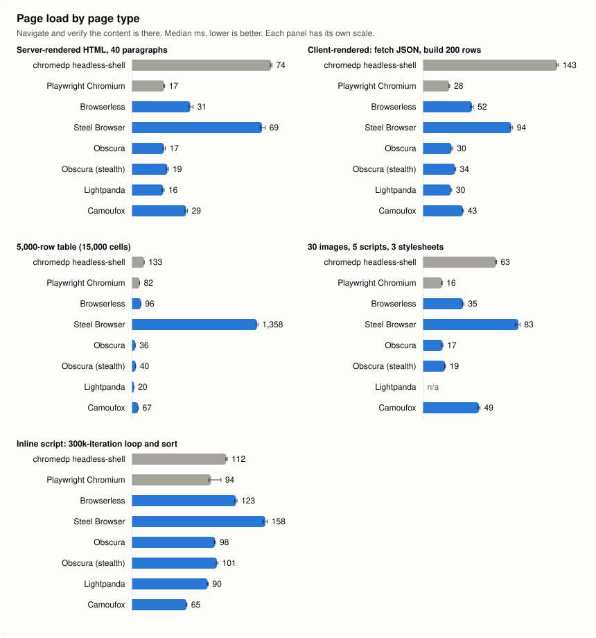
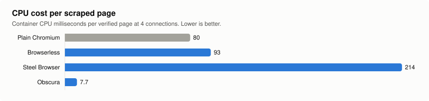

# browser-infra-bench

A reproducible benchmark of self-hosted headless browsers for AI agents and scrapers. Six contenders (**Lightpanda**, **Obscura**, **Obscura stealth**, **Camoufox**, **Browserless**, **Steel Browser**) and two Chromium references, all driven by the same Playwright workloads in identically limited containers against a deterministic fixture site.


The animation replays measured median throughput at 8 connections in real time. It is drawn from the results data, not screen-recorded.

Last run: 2026-11-25, 5 rounds. Full tables are in [results/RESULTS.md](results/RESULTS.md) and the raw samples in [results/raw](results/raw).

## The short version

There is no single winner. The fast ones are not Chromium and break things Chromium does; the compatible ones cost 10x to 100x more CPU and memory.

| If you need | Pick | Evidence |
| --- | --- | --- |
| Maximum throughput for HTML and JS scraping, no rendering | **Lightpanda** | 697 verified pages/s at 8 connections, 5 ms of CPU per page, 10 MB idle. It does not render: screenshots come back blank, images are not loaded, and it failed 11 of 85 checks. |
| High throughput with real rendering | **Obscura** | 455 pages/s, 8 ms of CPU per page, 15 MB idle, and correct screenshots and PDFs. Failed 10 of 85 checks. |
| Everything Playwright can do, working | **Playwright's own Chromium** | 85 of 85 checks and 82 pages/s. Per-page load times match Obscura's. |
| Chromium behind a managed service | **Browserless** | 83 of 85 checks. About 40 pages/s, half the plain Playwright reference. |
| The smallest automation fingerprint | **Camoufox** | Exposed 1 of 14 signals, the fewest. By far the heaviest: 6.6 pages/s, about 275 ms of CPU per page, and it hit the 4 GB memory limit. |
| A session API with a live viewer, Apache-2.0 | **Steel Browser** | Slowest Chromium here at 15 pages/s, with 2 flaky checks. Its bundled features were not scored. |

Two results that changed my mind while building this:

- **Obscura is not faster than Chromium per page load.** Against a properly launched Chromium it ties on four of five page types (17 vs 17 ms, 30 vs 28 ms, 17 vs 16 ms, 98 vs 94 ms) and wins only the large table (36 vs 82 ms). Its advantage is resource use: 5.6x the throughput at 8 connections, about 6x less CPU per page and 18x less idle memory.
- **Obscura's stealth build did not expose fewer signals than the normal build** on this list (3 of 14 for both), and it was 37% slower at 8 connections. Stealth features this benchmark does not measure, such as TLS impersonation and tracker blocking, may still matter.

## Results

### Session start

<picture><source media="(prefers-color-scheme: dark)" srcset="results/charts/session-start-dark.svg"></picture>

"Opening a session" is a different operation for each. Browserless and the Playwright reference launch a new Chromium per connection. Steel relaunches Chromium through its session API. The others attach to a process that is already running. The number is what a client waits either way.

### Page load

<picture><source media="(prefers-color-scheme: dark)" srcset="results/charts/page-load-dark.svg"></picture>

- Lightpanda shows n/a on the image-heavy page because it never loads the images, so the content check fails.
- Steel took 1,358 ms on the 5,000-row table, against 82 to 133 ms for the other Chromium builds. I did not isolate the cause. Steel loads a session-recording extension by default, which is a plausible suspect but untested.
- Camoufox was fastest on the script-heavy page (65 ms). It is the only one running Firefox's JavaScript engine instead of V8.

### Throughput

<picture><source media="(prefers-color-scheme: dark)" srcset="results/charts/throughput-dark.svg"></picture>

Each run scrapes 400 distinct pages, one fresh tab per page, and checks a per-page token so wrong data counts as a failure.

- Lightpanda, Obscura and the Playwright reference scale with connections. Browserless stays flat near 40. Steel peaks at 19 with 4 connections; it allows one session at a time, so its connections share one browser.
- Seven of the eight returned correct data for all 6,000 pages each.
- **Camoufox did not.** It returned 5,751 of 6,000. Memory grew to the 4 GB container limit during the runs, and the failures were "Browser closed" errors. This workload opens and closes 400 tabs in one long-lived Firefox; I did not test whether recycling the browser avoids it.

### Memory and CPU

<picture><source media="(prefers-color-scheme: dark)" srcset="results/charts/memory-dark.svg"></picture>

<picture><source media="(prefers-color-scheme: dark)" srcset="results/charts/cpu-per-page-dark.svg"></picture>

Obscura's README claims 30 MB of memory and 85 ms page loads. Measured here: 15 to 20 MB with zero or one tab, and 17 to 36 ms on the non-compute pages. Its README also claims Chrome needs about 500 ms for a static page; the Playwright reference did it in 17 ms.

### Compatibility

<picture><source media="(prefers-color-scheme: dark)" srcset="results/charts/compat-dark.svg"></picture>

85 checks through Playwright, each with a fixed expected answer, repeated in all 5 rounds. A check only counts if it passed every time. The per-check table and error messages are in [results/RESULTS.md](results/RESULTS.md#compatibility).

- **Lightpanda (74/85):** no painted screenshots, no image loading, no computed CSS colours, no canvas pixels, no iframes through Playwright, no web workers, no scrolling, no dark-mode emulation, no download events. Most of these follow from having no renderer.
- **Obscura (75/85):** clicking a link did not navigate; WebSockets from the page did not complete; `alert()` raised no dialog event; `page.route` did not block images; no download or page-error events; `setInputFiles` threw; `import()` of a `data:` URL was refused; navigation timing entries were missing; CDP `DOM.getDocument` did not return a usable root.
- **Obscura stealth (74/85):** the same ten, and `setExtraHTTPHeaders` did not reach the server.
- **Camoufox (81/85):** `page.evaluate` cannot see variables defined by the page's own scripts (it runs in an isolated world by design), and navigation timing entries were missing. PDF export and raw CDP sessions are Chromium-only in Playwright, so those two are structural.
- **Steel (81/85):** `page.goBack()` timed out every round and full-page screenshots came out at the wrong width. Two viewport checks were flaky.
- **Browserless (83/85):** `page.goBack()` timed out every round, and a viewport set before the first navigation was dropped.
- **Both Chromium references:** 85/85.

Seven public sites were also loaded with a content assertion each, 10 times per browser. Everything passed except an infinite-scroll page: Lightpanda 0 of 10, Obscura 8 of 10, Obscura stealth 7 of 10.

### Automation signals

<picture><source media="(prefers-color-scheme: dark)" srcset="results/charts/fingerprint-dark.svg"></picture>

This counts which of 14 well-known headless or automation tells each default configuration shows to a page on the local fixture site. It is a self-check of the fingerprint. It is not a test against any anti-bot product and says nothing about whether a real site would block these browsers. Lightpanda's low count needs context: it announces itself with the User-Agent `Lightpanda/1.0`, which this list does not penalise.

## Method

- **Same workloads for everyone.** Playwright 1.65.1 on Node 22. Six browsers connect with `connectOverCDP`. Two do not speak CDP and use Playwright's own protocol: the Playwright reference, and Camoufox, which needs a Playwright 1.50 client.
- **Same box for everyone.** Each browser runs alone in a Docker container limited to 4 CPUs and 4 GB, on one bridge network with the fixture server. Host: Apple M4 Max, Docker Desktop, linux/arm64 images, no emulation.
- **Two references.** `mcr.microsoft.com/playwright` running `playwright run-server` is Chromium launched the way Playwright itself launches it. `chromedp/headless-shell` is a bare headless shell at its image defaults; it is included because it is the lightest way to get Chromium over CDP, and it is clearly the slower of the two.
- **Deterministic pages.** The fixture site in [fixtures](fixtures) is a dependency-free Node server. Workloads verify content before stopping the clock, so a fast wrong answer is a failure.
- **Order effects.** 5 rounds, with browser order shuffled each round from a fixed seed. Each round starts from a fresh container.
- **Statistics.** Timings pool 75 trials per browser (15 per round). Tables give the median with a 95% bootstrap confidence interval. Command latency uses 1,000 calls per browser.
- **Resources.** Memory and CPU come from the kernel's cgroup counters for each container, sampled about 20 times a second.

Image digests and browser versions are recorded in [results/raw/meta.json](results/raw/meta.json). Obscura stealth and Camoufox have no official server image, so the Dockerfiles in [docker](docker) wrap their official release artifacts.

## Limitations

- **One machine, one run date.** Images were pulled as `:latest` on 2026-11-24. Results will drift as the projects ship.
- **One interrupted round.** The host went to sleep during round 1 while Steel was running. That Steel round was rerun on its own afterwards and replaced; every other file was scanned for stalled samples and none were found.
- **Self-hosted images only, on a localhost network.** Client and browser are on the same machine. Nothing here measures any hosted service.
- **Default configurations only.** No proxies and no tuning of Steel, Browserless or Camoufox options.
- **Camoufox is driven by an older client.** Its server only started with Playwright 1.50, so its numbers come from a 1.50 client while the rest use 1.65.
- **Small pages.** The fixtures are synthetic. The real-site set is seven pages and is there for correctness, not timing.
- **The checks are mine.** 85 checks cover common Playwright use. They are not a conformance suite, and a different selection would move the scores.
- **Features are not scored.** Steel's session viewer and recording, Browserless's REST APIs and queueing, and the MCP servers in Obscura and Lightpanda are outside this benchmark.

## Run it yourself

Needs Docker and Node 22.

```bash
npm install
docker build -t bench/obscura-stealth docker/obscura-stealth
docker build -t bench/camoufox docker/camoufox
npm run bench:quick   # about 10 minutes, 1 round, writes results/quick
npm run bench         # about 90 minutes, 5 rounds, writes results/raw
npm run report        # rebuilds results/RESULTS.md, summary.json and the charts
npm run race          # rebuilds the animation (needs ffmpeg)
```

Keep the machine awake and otherwise idle during a run (`caffeinate -i npm run bench` on macOS).

Useful flags for `src/run.ts`: `--providers steel,obscura`, `--rounds 2`, `--only compat,fingerprint`, `--seed 1`. Set `BENCH_CPUS` and `BENCH_MEMORY_GB` to change container limits.

## Layout

```
src/providers.ts   one adapter per browser: container, readiness, how to open a session
src/workloads.ts   the measured workloads
src/compat.ts      the 85 compatibility checks
src/run.ts         runner
src/report.ts      aggregation, tables and charts
src/race.ts        the animated replay
docker/            images for the two browsers without an official server image
fixtures/          the fixture site
results/           raw samples, summary, charts
```

To add a browser, add an entry to `src/providers.ts`.

## License

MIT for this repository. The browsers under test carry their own licenses: Steel and Obscura are Apache-2.0, Camoufox is MPL-2.0, Lightpanda is AGPL-3.0, and Browserless is SSPL-1.0 or commercial.
