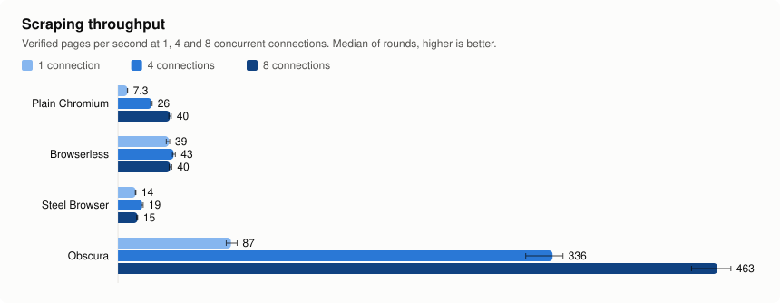
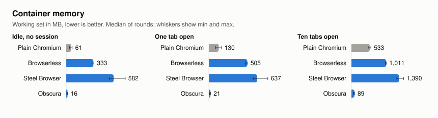
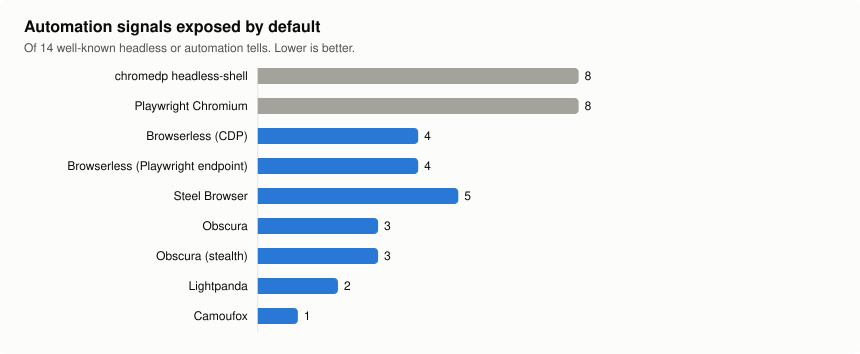

# browser-infra-bench

A reproducible benchmark of self-hosted headless browsers for AI agents and scrapers: **Steel Browser**, **Browserless** and **Obscura**, with plain headless Chromium as the reference. All four are driven by the same stock Playwright client over CDP, in identically limited containers, against a deterministic fixture site.


The animation replays measured median throughput at 8 connections in real time. It is drawn from the results data, not screen-recorded.

Last run: 2026-11-24, 5 rounds. Full tables are in [results/RESULTS.md](results/RESULTS.md) and the raw samples in [results/raw](results/raw).

## The short version

There is no single winner. It depends on whether you need speed or Chromium-exact behaviour.

| If you care most about | Pick | Evidence |
| --- | --- | --- |
| Speed, memory and CPU | **Obscura** | 463 verified pages/s at 8 connections against 40 for Browserless and 15 for Steel. About 8 ms of CPU per page against 80 to 260. 16 MB idle against 333 MB and 582 MB. |
| Chromium behaviour behind a managed service | **Browserless** | 82 of 84 Playwright checks, no flaky ones. Faster than Steel on every timing measured and faster than the plain Chromium image on page loads. |
| Fewest surprises with Playwright | **Plain Chromium** | The only one to pass all 84 checks. |
| A session API, live viewer and Apache-2.0 license | **Steel** | Slowest of the four here, with 3 flaky checks, but it bundles features the others do not. Those features were not scored. |

Obscura's speed comes with a cost: it is its own engine, not Chromium, and it failed 10 of 84 checks in every round. See [what it could not do](#compatibility).

## Results

### Session start

<picture><source media="(prefers-color-scheme: dark)" srcset="results/charts/session-start-dark.svg"></picture>

"Opening a session" is a different operation for each. Browserless launches a new Chromium process per connection. Steel relaunches Chromium through its session API. Obscura and the plain image attach to a process that is already running. The number is what a client waits either way.

### Page load

<picture><source media="(prefers-color-scheme: dark)" srcset="results/charts/page-load-dark.svg"></picture>

Obscura is fastest on all five page types, by 2x to 4x on four of them. On the script-heavy page the gap closes to 97 ms against 111 to 155 ms, which fits all four running V8.

Steel took 1,362 ms on the 5,000-row table, against 96 ms for Browserless and 131 ms for plain Chromium. I did not isolate the cause. Steel loads a session-recording extension by default, which is a plausible suspect but untested.

### Throughput

<picture><source media="(prefers-color-scheme: dark)" srcset="results/charts/throughput-dark.svg"></picture>

Each run scrapes 400 distinct pages, one fresh tab per page, and checks a per-page token so wrong data counts as a failure. All 24,000 extractions across all browsers and rounds were correct.

Obscura scales with connections (87, 336, 463 pages/s). Browserless stays flat at about 40. Steel peaks at 19 with 4 connections and drops to 15 with 8. Steel allows one session at a time, so its connections share one browser.

### Memory and CPU

<picture><source media="(prefers-color-scheme: dark)" srcset="results/charts/memory-dark.svg"></picture>

<picture><source media="(prefers-color-scheme: dark)" srcset="results/charts/cpu-per-page-dark.svg"></picture>

Peak memory during the 8-connection throughput run was 43 MB for Obscura, 244 MB for plain Chromium, 1,027 MB for Steel and 2,687 MB for Browserless, which runs one Chromium per connection.

Obscura's README claims 30 MB of memory and 85 ms page loads. Measured here: 16 to 21 MB with zero or one tab, and 16 to 36 ms on the non-compute pages. Its claim holds on this workload.

### Compatibility

<picture><source media="(prefers-color-scheme: dark)" srcset="results/charts/compat-dark.svg"></picture>

84 checks through stock Playwright, each with a fixed expected answer, repeated in all 5 rounds. A check only counts if it passed every time.

- **Obscura (74/84)** failed, in every round:
  - Clicking a link did not navigate.
  - WebSocket connections from the page did not complete.
  - `alert()` raised no dialog event.
  - `page.route` did not block image requests.
  - Downloads raised no download event.
  - Uncaught page errors were not reported.
  - `setInputFiles` threw.
  - `import()` of a `data:` URL was refused.
  - Navigation timing entries were missing.
  - CDP `DOM.getDocument` did not return a usable root.
- **Steel (80/84)** failed `page.goBack()` every round. Three viewport checks were flaky: an emulated viewport sometimes reverted to the 1920x1080 window.
- **Browserless (82/84)** failed `page.goBack()` every round, and a viewport set before the first navigation was dropped.
- **Plain Chromium** passed everything.

The `goBack` and viewport failures show up on both products that launch full Chrome themselves and not on the plain image. I did not establish the root cause.

Seven public sites were also loaded with a content assertion each, 10 times per browser. Everything passed except one Obscura timeout out of 10 on an infinite-scroll page.

### Automation signals

<picture><source media="(prefers-color-scheme: dark)" srcset="results/charts/fingerprint-dark.svg"></picture>

This counts which of 14 well-known headless or automation tells each default configuration shows to a page on the local fixture site. It is a self-check of the fingerprint. It is not a test against any anti-bot product and says nothing about whether a real site would block these browsers. Optional stealth modes were not enabled.

## Method

- **Same client for everyone.** Playwright 1.65.1 on Node 22, `chromium.connectOverCDP`, using each project's documented connection method.
- **Same box for everyone.** Each browser runs alone in a Docker container limited to 4 CPUs and 4 GB, on one bridge network with the fixture server. Host: Apple M4 Max, Docker Desktop, linux/arm64 images, no emulation.
- **Deterministic pages.** The fixture site in [fixtures](fixtures) is a dependency-free Node server. Workloads verify content before stopping the clock, so a fast wrong answer is a failure.
- **Order effects.** 5 rounds, with browser order shuffled each round from a fixed seed. Each round starts from a fresh container.
- **Statistics.** Timings pool 75 trials per browser (15 per round). Tables give the median with a 95% bootstrap confidence interval. Command latency uses 1,000 calls per browser.
- **Resources.** Memory and CPU come from the kernel's cgroup counters for each container, sampled about 20 times a second, not from `docker stats`.

Image digests and browser versions are recorded in [results/raw/meta.json](results/raw/meta.json).

## Limitations

- **One machine, one run date.** Images were pulled as `:latest` on 2026-11-24. Results will drift as the projects ship.
- **Self-hosted images only, on a localhost network.** Client and browser are on the same machine. Nothing here measures any hosted service.
- **The reference is not tuned.** `chromedp/headless-shell` runs with its image defaults (old headless mode, SwiftShader, a socat proxy on the debug port). It is slower than Browserless on page loads, so treat it as a reference point and not as the ceiling for Chromium.
- **Default configurations only.** No stealth flags, no proxies, no tuning of Steel or Browserless options.
- **Small pages.** The fixtures are synthetic. The real-site set is seven pages and is there for correctness, not timing.
- **The checks are mine.** 84 checks cover common Playwright use. They are not a conformance suite, and a different selection would move the scores.
- **Features are not scored.** Steel's session viewer and recording, Browserless's REST APIs and queueing, and Obscura's MCP server are outside this benchmark.

## Run it yourself

Needs Docker and Node 22.

```bash
npm install
npm run bench:quick   # about 5 minutes, 1 round, writes results/quick
npm run bench         # about 45 minutes, 5 rounds, writes results/raw
npm run report        # rebuilds results/RESULTS.md, summary.json and the charts
npm run race          # rebuilds the animation (needs ffmpeg)
```

Useful flags for `src/run.ts`: `--providers steel,obscura`, `--rounds 2`, `--only compat,fingerprint`, `--seed 1`. Set `BENCH_CPUS` and `BENCH_MEMORY_GB` to change container limits.

## Layout

```
src/providers.ts   one adapter per browser: container, readiness, how to open a session
src/workloads.ts   the measured workloads
src/compat.ts      the 84 compatibility checks
src/run.ts         runner
src/report.ts      aggregation, tables and charts
src/race.ts        the animated replay
fixtures/          the fixture site
results/           raw samples, summary, charts
```

To add a browser, add an entry to `src/providers.ts`. A hosted provider only needs `open()` to create a session through its API and return the CDP URL.

## License

MIT for this repository. The browsers under test carry their own licenses: Steel and Obscura are Apache-2.0, and Browserless is SSPL-1.0 or commercial.
