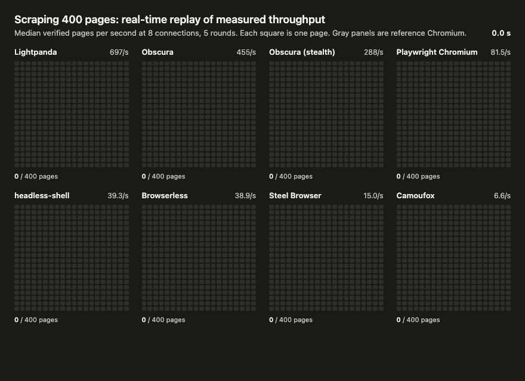
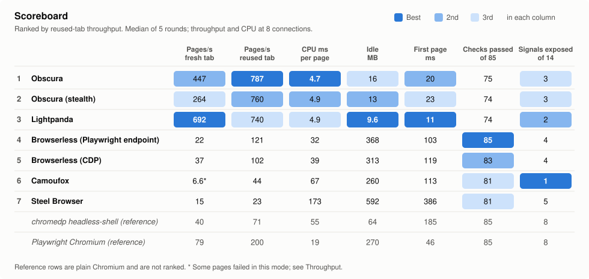
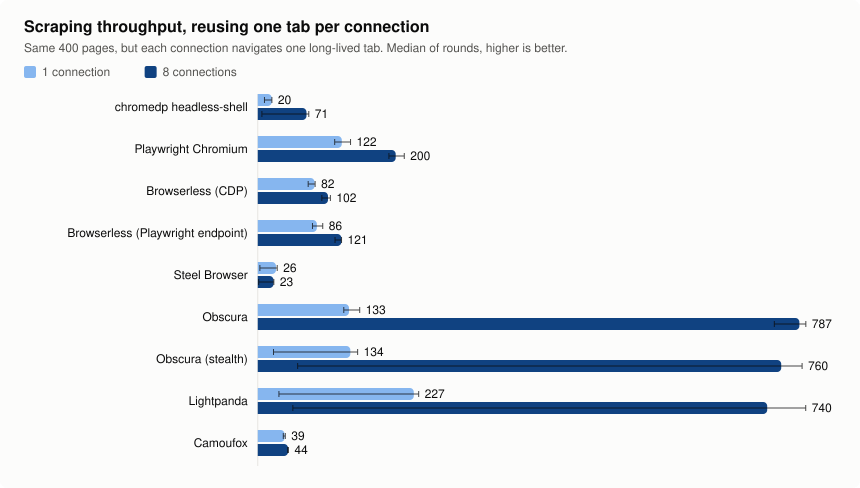
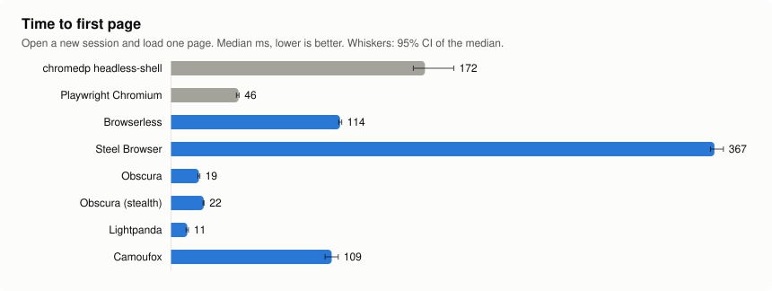
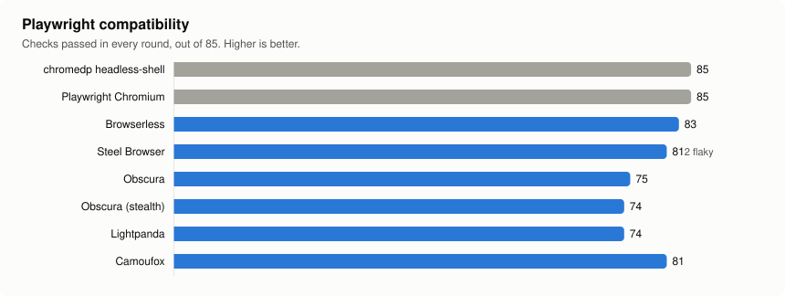

<h1 align="center">browser-infra-bench</h1>

<p align="center">
  <b>Which self-hosted headless browser should an AI agent or scraper use?</b><br>
  Seven browser setups and two Chromium references, same workloads, same container limits, measured.
</p>

<p align="center">
  
  
  
  
</p>

<p align="center">
  <a href="#scoreboard">Scoreboard</a> ·
  <a href="#which-one-should-you-use">Which one?</a> ·
  <a href="#results">Results</a> ·
  <a href="#method">Method</a> ·
  <a href="#limitations">Limitations</a> ·
  <a href="#run-it-yourself">Run it</a> ·
  <a href="results/RESULTS.md">Full tables</a>
</p>



<p align="center"><sub>Real-time replay of measured median throughput (8 connections, one reused tab each). Drawn from the results data, not screen-recorded.</sub></p>

## Scoreboard

> **Fastest: Obscura.** **Lightest: Lightpanda.** **Most compatible: Browserless.** **Hardest to fingerprint: Camoufox.**
> Best overall for high-volume work that still needs rendering: **Obscura**. Best if everything has to work: **Browserless** through its Playwright endpoint.

<!-- scoreboard:start -->
| Category | Winner | Runner-up |
| --- | --- | --- |
| Throughput, reused tab | **Obscura** (787 pages/s) | Obscura (stealth) (760) |
| Throughput, fresh tab | **Lightpanda** (692 pages/s) | Obscura (447) |
| CPU per page | **Obscura** (4.7 ms) | Obscura (stealth) (4.9) |
| Idle memory | **Lightpanda** (9.6 MB) | Obscura (stealth) (13) |
| Time to first page | **Lightpanda** (11 ms) | Obscura (20) |
| Playwright compatibility | **Browserless (Playwright endpoint)** (85 of 85 checks) | Browserless (CDP) (83) |
| Smallest automation fingerprint | **Camoufox** (1 of 14 signals) | Lightpanda (2) |

Category wins: Lightpanda 3, Obscura 2, Browserless (Playwright endpoint) 1, Camoufox 1. No browser wins on both speed and compatibility, so the ranking below is by speed with compatibility next to it.

<picture><source media="(prefers-color-scheme: dark)" srcset="results/charts/scoreboard-dark.svg"></picture>

<details><summary>Same numbers as a text table</summary>

| # | Browser | Pages/s, fresh tab | Pages/s, reused tab | CPU ms/page | Idle MB | First page ms | Checks passed (of 85) | Signals exposed (of 14) |
| ---: | --- | ---: | ---: | ---: | ---: | ---: | ---: | ---: |
| 1 | Obscura | 447 | **787** | **4.7** | 16 | 20 | 75 | 3 |
| 2 | Obscura (stealth) | 264 | 760 | 4.9 | 13 | 23 | 74 | 3 |
| 3 | Lightpanda | **692** | 740 | 4.9 | **9.6** | **11** | 74 | 2 |
| 4 | Browserless (Playwright endpoint) | 22 | 121 | 32 | 368 | 103 | **85** | 4 |
| 5 | Browserless (CDP) | 37 | 102 | 39 | 313 | 119 | 83 | 4 |
| 6 | Camoufox | 6.6 \* | 44 | 67 | 260 | 113 | 81 | **1** |
| 7 | Steel Browser | 15 | 23 | 173 | 592 | 386 | 81 | 5 |
|  | *chromedp headless-shell (reference)* | 40 | 71 | 55 | 64 | 185 | 85 | 8 |
|  | *Playwright Chromium (reference)* | 79 | 200 | 19 | 270 | 46 | 85 | 8 |

Bold is the best contender in each column. CPU is for the reused-tab mode. \* Some pages failed; see [Throughput](#throughput).

</details>
<!-- scoreboard:end -->

## Which one should you use?

There is no single winner. The fast engines are not Chromium and break things Chromium does; the Chromium-based ones cost 4x to 37x more CPU per page.

| If you need | Use | Why |
| --- | --- | --- |
| A safe default | **Plain Playwright Chromium**, or **Browserless** through its Playwright endpoint if you want it as a service | Both pass 85 of 85 checks. Browserless gives up about 40% of the reference's throughput (121 vs 200 pages/s). |
| Volume, with screenshots and PDFs | **Obscura** | 787 pages/s and 4.7 ms of CPU per page, about 4x the Chromium reference on a quarter of the CPU, in 16 MB idle. Test your flows first: it failed 10 of 85 checks. |
| Volume, text and DOM only | **Lightpanda** | The lightest (10 MB idle) and the fastest at low concurrency. It does not render, so no screenshots, images or computed styles. |
| The smallest automation fingerprint | **Camoufox** | Exposed 1 of 14 signals. Reuse tabs: with a fresh tab per page it ran out of memory. |
| A session API with a live viewer | **Steel Browser** | Slowest with reused tabs (23 pages/s) and the most CPU per page. Its bundled features were not scored. |

**My pick:** start on plain Playwright Chromium (or Browserless if you want a managed endpoint), because everything works. Move the high-volume part of the job to Obscura once CPU or memory is what you are paying for, after checking it against the gaps listed under [Compatibility](#compatibility).

Three results that surprised me:

- **Obscura is not faster than Chromium per page load.** Against a properly launched Chromium it is within a few milliseconds on four of five page types and wins only the large table (37 vs 85 ms). Its advantage is resource use.
- **How you use tabs matters more than which Chromium wrapper you pick.** Reusing one tab instead of opening a fresh one per page made every browser faster: 2.5x for the Playwright reference, 5.6x for Browserless's Playwright endpoint, 6.7x for Camoufox.
- **Obscura's stealth build scores the same as the normal build here (3 of 14), and that is expected.** Obscura's browser-profile fingerprint is built into both builds. Stealth changes the network layer, which this benchmark does not score. I checked that it was active: see [Automation signals](#automation-signals). It was 41% slower with fresh tabs and about the same with reused tabs.

## Results

Charts show medians over 5 rounds. Gray bars are the two Chromium references. Every number, with confidence intervals, is in [results/RESULTS.md](results/RESULTS.md).

### Throughput

<picture><source media="(prefers-color-scheme: dark)" srcset="results/charts/throughput-reuse-dark.svg"></picture>

<picture><source media="(prefers-color-scheme: dark)" srcset="results/charts/throughput-dark.svg"></picture>

Each run scrapes 400 distinct pages and checks a per-page token, so wrong data counts as a failure. It is run two ways: each connection reusing one tab, and a fresh tab for every page.

- **Reused tabs:** every browser returned all 2,000 pages correctly at both concurrency levels.
- **Fresh tabs:** eight of nine returned all 6,000 pages. **Camoufox returned 5,741 of 6,000**: memory grew to the 4 GB container limit and the failures were "Browser closed" errors.
- With reused tabs, Steel is the only one that gets slower with more connections (26 pages/s at 1, 23 at 8). It allows one session at a time, so its connections share one browser.
- Browserless's two endpoints trade places: CDP is faster with fresh tabs (37 vs 22 pages/s), the Playwright endpoint with reused tabs (121 vs 102).

### Page load

<picture><source media="(prefers-color-scheme: dark)" srcset="results/charts/page-load-dark.svg"></picture>

- Lightpanda shows n/a on the image-heavy page because it never loads the images, so the content check fails.
- Steel took 1,385 ms on the 5,000-row table, against 85 to 135 ms for the other Chromium setups. Turning off its fingerprint injection did not change this. It loads a session-recording extension by default, which is a plausible suspect but untested.
- Camoufox was fastest on the script-heavy page (66 ms). It is the only one running Firefox's JavaScript engine instead of V8.

### Session start

<picture><source media="(prefers-color-scheme: dark)" srcset="results/charts/session-start-dark.svg"></picture>

"Opening a session" is a different operation for each. Browserless and the Playwright reference launch a new Chromium per connection. Steel relaunches Chromium through its session API. The others attach to a process that is already running. The number is what a client waits either way.

### Memory and CPU

<picture><source media="(prefers-color-scheme: dark)" srcset="results/charts/memory-dark.svg"></picture>

<picture><source media="(prefers-color-scheme: dark)" srcset="results/charts/cpu-per-page-dark.svg"></picture>

Obscura's README claims 30 MB of memory and 85 ms page loads. Measured here: 16 to 21 MB with zero or one tab, and 19 to 37 ms on the non-compute pages. Its README also puts Chrome at about 500 ms for a static page; the Playwright reference did it in 18 ms.

### Compatibility

<picture><source media="(prefers-color-scheme: dark)" srcset="results/charts/compat-dark.svg"></picture>

85 checks through Playwright, each with a fixed expected answer, repeated in all 5 rounds. A check only counts if it passed every time.

<details>
<summary><b>What each browser failed</b></summary>

- **Lightpanda (74/85):** no painted screenshots, no image loading, no computed CSS colours, no canvas pixels, no iframes through Playwright, no web workers, no scrolling, no dark-mode emulation, no download events. Most of these follow from having no renderer.
- **Obscura (75/85):** clicking a link did not navigate; WebSockets from the page did not complete; `alert()` raised no dialog event; `page.route` did not block images; no download or page-error events; `setInputFiles` threw; `import()` of a `data:` URL was refused; navigation timing entries were missing; CDP `DOM.getDocument` did not return a usable root.
- **Obscura stealth (74/85):** the same ten, and `setExtraHTTPHeaders` did not reach the server.
- **Camoufox (81/85):** `page.evaluate` cannot see variables defined by the page's own scripts. Camoufox runs it in an isolated world by default and documents an opt-in for main-world access. Navigation timing entries were missing. PDF export and raw CDP sessions are Chromium-only in Playwright, so those two are structural.
- **Steel (81/85):** `page.goBack()` timed out every round. Three viewport and screenshot-size checks were flaky. In a side test all three passed with `SKIP_FINGERPRINT_INJECTION=true`; Steel's fingerprint injection sets page metrics itself.
- **Browserless over CDP (83/85):** `page.goBack()` timed out every round, and a viewport set before the first navigation was dropped.
- **Browserless through its Playwright endpoint (85/85)** and **both Chromium references (85/85):** everything passed.

The per-check table and error messages are in [results/RESULTS.md](results/RESULTS.md#compatibility).

</details>

Seven public sites were also loaded with a content assertion each, 10 times per browser. Everything passed except an infinite-scroll page: Lightpanda 0 of 10, Obscura and Obscura stealth 6 of 10.

### Automation signals

<picture><source media="(prefers-color-scheme: dark)" srcset="results/charts/fingerprint-dark.svg"></picture>

This counts which of 14 well-known headless or automation tells each default configuration shows to a page on the local fixture site. It is a self-check of the fingerprint. **It is not a test against any anti-bot product** and says nothing about whether a real site would block these browsers. Lightpanda's low count needs context: it announces itself with the User-Agent `Lightpanda/1.0`, which this list does not penalise.

**Obscura stealth is a network-layer feature, so this list cannot show its effect.** A separate check confirmed it was switched on in the build tested:

| | Normal build | Stealth build with `--stealth` |
| --- | --- | --- |
| TLS fingerprint (JA4), as seen by tls.peet.ws | `t13d1011h1_61a7ad8aa9b6_3fcd1a44f3e3` | `t13d1516h2_8daaf6152771_d8a2da3f94cd` |
| HTTP version negotiated | HTTP/1.1 | HTTP/2 |
| Loading a Google Tag Manager script | Request sent, 200 | No request sent, script `onerror` |

Both the stealth build and the flag are needed: the stealth build without `--stealth`, and the normal build with it, kept the normal JA4. Whether the stealth fingerprint passes any particular bot detector was not tested.

## Method

- **Same workloads for everyone.** Playwright 1.65.1 on Node 22. Six setups connect with `connectOverCDP`. Three use Playwright's own protocol: the Playwright reference, Browserless's Playwright endpoint, and Camoufox, which has no CDP and needs a Playwright 1.50 client.
- **Each project's documented setup.** Connection methods and flags follow each project's README or docs. Where the docs offer a second route that changes results (Browserless), both are measured.
- **Same box for everyone.** Each browser runs alone in a Docker container limited to 4 CPUs and 4 GB, on one bridge network with the fixture server. Host: Apple M4 Max, Docker Desktop, linux/arm64 images, no emulation.
- **Two references.** `mcr.microsoft.com/playwright` running `playwright run-server` is Chromium launched the way Playwright itself launches it. `chromedp/headless-shell` is a bare headless shell at its image defaults; it is the lightest way to get Chromium over CDP and clearly the slower of the two.
- **Deterministic pages.** The fixture site in [fixtures](fixtures) is a dependency-free Node server. Workloads verify content before stopping the clock, so a fast wrong answer is a failure.
- **Order effects.** 5 rounds, with browser order shuffled each round from a fixed seed. Each round starts from a fresh container.
- **Statistics.** Timings pool 75 trials per browser (15 per round). Tables give the median with a 95% bootstrap confidence interval. Command latency uses 1,000 calls per browser.
- **Resources.** Memory and CPU come from the kernel's cgroup counters for each container, sampled about 20 times a second.

Image digests and browser versions are recorded in [results/raw/meta.json](results/raw/meta.json). Obscura stealth and Camoufox have no official server image, so the Dockerfiles in [docker](docker) wrap their official release artifacts.

## Limitations

- **One machine, one run date.** Images were pulled as `:latest` on 2026-11-24 and 25. Results will drift as the projects ship.
- **Self-hosted images only, on a localhost network.** Client and browser are on the same machine. Nothing here measures any hosted service.
- **Default configurations.** No proxies and no tuning. Two side tests checked that defaults were not holding a browser back: Obscura with `--workers 4` was no faster (395 vs 447 pages/s), and Lightpanda with telemetry off was unchanged. Lightpanda sends usage telemetry by default; it is turned off in this harness.
- **Camoufox runs through its experimental server.** Its docs call the remote server experimental. It only started with Playwright 1.50, so its numbers come from a 1.50 client while the rest use 1.65.
- **Small pages.** The fixtures are synthetic. The real-site set is seven pages and is there for correctness, not timing.
- **The checks are mine.** 85 checks cover common Playwright use. They are not a conformance suite, and a different selection would move the scores.
- **Features are not scored.** Steel's session viewer and recording, Browserless's REST APIs and queueing, and the MCP servers in Obscura and Lightpanda are outside this benchmark.

## Run it yourself

Needs Docker and Node 22.

```bash
npm install
docker build -t bench/obscura-stealth docker/obscura-stealth
docker build -t bench/camoufox docker/camoufox
npm run bench:quick   # about 15 minutes, 1 round, writes results/quick
npm run bench         # about 2.5 hours, 5 rounds, writes results/raw
npm run report        # rebuilds results/RESULTS.md, the charts and the scoreboard above
npm run race          # rebuilds the animation (needs ffmpeg)
```

Keep the machine awake and otherwise idle during a run (`caffeinate -i npm run bench` on macOS).

Useful flags for `src/run.ts`: `--providers steel,obscura`, `--rounds 2`, `--only compat,fingerprint`, `--seed 1`. Set `BENCH_CPUS` and `BENCH_MEMORY_GB` to change container limits.

## Add a browser

1. Add an entry to [src/providers.ts](src/providers.ts): the image, how to tell it is ready, and how to open a session. Most are about ten lines.
2. Run `npx tsx src/run.ts --quick --providers your-id` and check the output.
3. Run the full benchmark and `npm run report`.

A hosted service works the same way: `open()` creates a session through its API and returns the endpoint.

## Layout

```
src/providers.ts   one adapter per browser
src/workloads.ts   the measured workloads
src/compat.ts      the 85 compatibility checks
src/run.ts         runner
src/report.ts      aggregation, tables, charts and the scoreboard
src/race.ts        the animated replay
docker/            images for the two browsers without an official server image
fixtures/          the fixture site
results/           raw samples, summary, charts
```

## License

MIT for this repository. The browsers under test carry their own licenses: Steel and Obscura are Apache-2.0, Camoufox is MPL-2.0, Lightpanda is AGPL-3.0, and Browserless is SSPL-1.0 or commercial.
